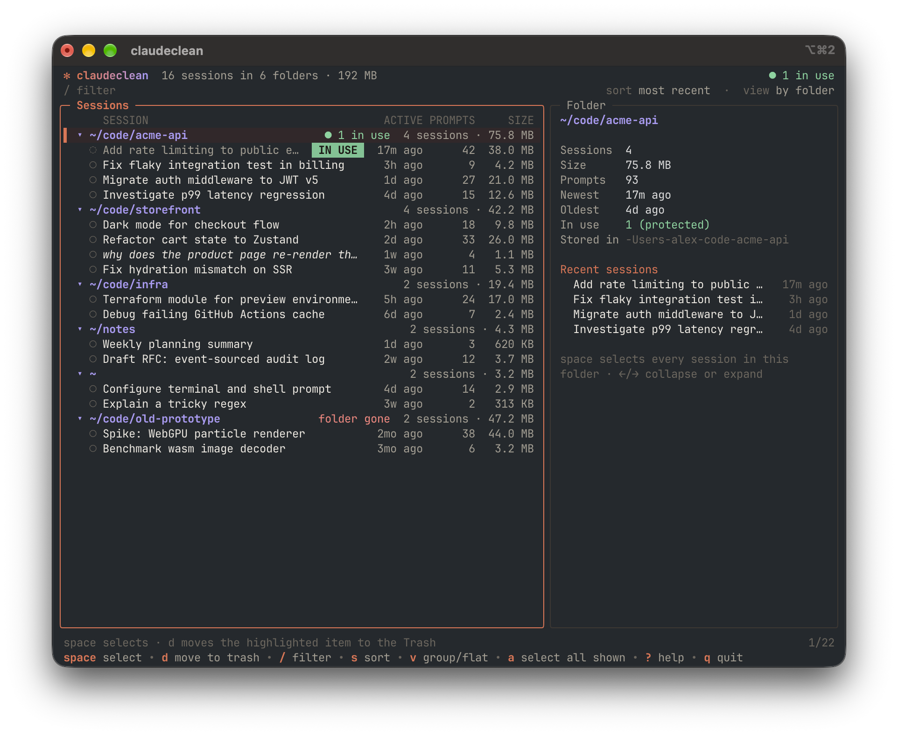

# `claudeclean`



Browse local Claude Code sessions by folder, move the ones you don't need to macOS Trash.

## Install

Requires Go 1.27+ and the Xcode command line tools.

```sh
make install
```

## Usage

```sh
claudeclean             # interactive
claudeclean --dry-run   # nothing is moved
claudeclean --list      # plain table
claudeclean --root DIR  # default: $CLAUDE_CONFIG_DIR or ~/.claude
claudeclean --log FILE  # default: ~/Library/Logs/claudeclean/trash-log.jsonl
```

`space` select, `d` move to Trash, `/` filter, `s` sort, `?` all keys.

## Safety

- Files go to the Trash, never deleted
- Only a session's own files move: its transcript, subagent dir, file history, session env, tasks, todos and debug log. Memory, history and settings are never touched
- Symlinks never followed
- Sessions open in Claude Code, or written to in the last two minutes, can't be moved
- Every path is re-checked right before it moves, and each move is logged with its Trash location

## Development

```sh
make check   # vet, staticcheck, tests with -race
make fuzz
```

`CLAUDECLEAN_TEST_REAL_TRASH=1 go test ./internal/trash` also exercises the real Trash.

## License

MIT
